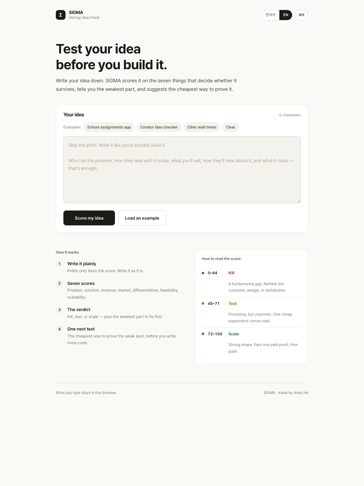
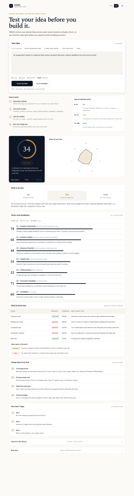
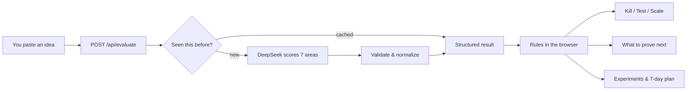

<a id="top"></a>

<div align="center">

# Σ&nbsp; SIGMA

### Test your startup idea before you build it.

Paste an idea. Get an honest read: a score across seven areas, a **kill / test / scale** verdict, and the single cheapest test to run next.

No signup. Works in Korean and English. One static site + one edge function — that's the whole thing.

[](https://pages.cloudflare.com/)
[](https://openrouter.ai/deepseek/deepseek-v4-flash-0731)
[](#run-it-locally)

[What you get](#what-you-get) · [How it works](#how-it-works) · [Run it locally](#run-it-locally) · [Project layout](#project-layout) · [API](#api)



</div>

---

## The idea

Building is cheap now. You can have a landing page, a prototype, and a few thousand lines of code before you've answered the only question that matters early on:

> **Is this a real, painful problem for a customer you can actually reach — and is there a business behind it?**

SIGMA is a fast, skeptical second opinion. Describe your idea the way you'd explain it to a co-founder — who it's for, what hurts today, how you'll reach them, what you'll charge — and it hands back a structured critique instead of a pat on the back.

It won't replace talking to customers. Think of it as a **pre-flight check that tells you what to go prove next.**

---

## What you get

For every idea you submit, SIGMA returns:

- a **0–100 score** with a one-line summary;
- a **seven-area breakdown**, each with its own score and a few sentences of analysis;
- a **kill / test / scale** verdict from rules you can read (below);
- **weak spots** — the hidden assumptions, contradictions, and overclaims in the pitch;
- **what to prove next** — each key claim tagged *observed*, *inferred*, or *guessed*, with a concrete proof step;
- **four cheap experiments** to run before writing more code;
- a **next-actions plan** for the verdict you got, a radar chart, a copy-paste report, raw JSON, and local history (last 8 runs per language, kept in your browser).

Keyboard-first, if that's your thing: `/` focuses the editor, `Cmd/Ctrl+Enter` scores the idea, and `Cmd/Ctrl+K` opens a command palette.

<div align="center">

</div>

### The seven areas it checks

| # | Area | The question | A strong idea shows… |
|---|---|---|---|
| 1 | **Problem** | Does this problem really exist? | a specific customer in recurring, costly, or urgent pain |
| 2 | **Solution** | Does the product actually fix it? | a believable link between the product and the outcome |
| 3 | **Revenue** | Can it make money? | plausible pricing, willingness to pay, and unit economics |
| 4 | **Market** | Is the reachable market big enough? | a meaningful market for the scale you're aiming at |
| 5 | **Differentiation** | Why this over the alternatives? | a real wedge or advantage that's hard to copy |
| 6 | **Feasibility** | Can you build and run it? | realistic tech, cost, regulation, and complexity |
| 7 | **Scalability** | Can growth repeat? | delivery and distribution that don't cost more every time |

Weak spots come with a severity so you know how much to worry:

| Severity | Meaning | What to do |
|---|---|---|
| `fatal` | a foundational contradiction | stop and rewrite the case |
| `warn` | a big assumption with no evidence | run a cheap test before scaling up |
| `minor` | incomplete but fixable | clarify the claim or gather a bit more data |

---

## Kill / Test / Scale

The verdict isn't a vibe — it's three rules, checked in order, that you can see in the client code:

```text
SCALE  if overall score >= 72
       and problem score  >= 65
       and at most 1 weak spot

KILL   if overall score < 45
       or differentiation score < 40

TEST   otherwise
```

A *scale* result still tells you to land one paying customer before betting bigger. The point is to make the reasoning legible, so a slick narrative can't hide a weak assumption.

---

## How it works



The split is deliberate: **the AI writes the analysis; the browser applies the rules.** That keeps the verdict, evidence tags, and experiments consistent and inspectable, no matter how persuasive the pitch sounds.

A few things happen along the way:

- **As you type,** the page shows lightweight hints (word count, whether you've mentioned price/customer/channel, a `draft → usable → filed` readiness). These only nudge your input — they never touch the score.
- **On the server** (a Cloudflare Pages Function), the request is rate-limited, validated (min 10 chars, capped at 3,000), and hashed. If the same idea + language was scored in the last 24 hours, the cached result comes straight back.
- **On a cache miss,** it calls `deepseek/deepseek-v4-flash-0731` via OpenRouter with a locale-aware prompt, a 25-second timeout, and up to three retries with backoff. The submitted idea is treated as untrusted text — the model is told to analyze it, never to follow instructions inside it.
- **Every area** is keyed by a stable id (`problem`, `revenue`, …), so Korean and English labels never change the decision logic.

---

## Run it locally

**You'll need:** Node.js 18+ and an [OpenRouter API key](https://openrouter.ai/keys). (A Cloudflare account is only needed to deploy.)

```bash
git clone https://github.com/ghandhitechnology/sigma-validator.git
cd sigma-validator
```

Put your key in a local `.dev.vars` file (it's git-ignored):

```dotenv
OPENROUTER_API_KEY=your_openrouter_api_key
```

Start the dev server:

```bash
npx wrangler pages dev public
```

Open the URL it prints (usually `http://localhost:8788`). That's it — no build, no bundler, no `npm install`.

---

## Project layout

Small on purpose. If you can read HTML, CSS, and one JS file, you can read all of SIGMA.

```text
sigma-validator/
├── public/                     # everything the browser loads (static)
│   ├── index.html              # language picker (KO / EN)
│   ├── en/index.html           # English page
│   ├── ko/index.html           # Korean page
│   ├── _headers                # security & cache headers
│   └── assets/
│       ├── app.js              # all the front-end behavior
│       ├── locale-selector.js  # remembers your language choice
│       ├── styles.css          # the whole design system
│       └── locales/
│           ├── en.js           # English copy + examples
│           └── ko.js           # Korean copy + examples
├── functions/
│   └── api/
│       └── evaluate.js         # the one edge function (scoring + reports)
├── wrangler.toml               # Cloudflare Pages config
└── docs/                       # README screenshots
```

No framework, no database, no build step. Two static pages and one edge function.

---

## Configuration (optional)

The scorer only needs `OPENROUTER_API_KEY`. Everything else is opt-in via Cloudflare KV — and if a binding is missing, that feature just quietly turns off.

| Binding | Adds | Kept for |
|---|---|---|
| `SIGMA_CACHE` | caches identical evaluations | 24 hours |
| `SIGMA_REPORTS` | shareable report links | 30 days |
| `SIGMA_ANALYTICS` | aggregate run/score/error counters | no expiry |

Bind them in `wrangler.toml`:

```toml
[[kv_namespaces]]
binding = "SIGMA_CACHE"
id = "<production-namespace-id>"
preview_id = "<preview-namespace-id>"
# repeat for SIGMA_REPORTS and SIGMA_ANALYTICS
```

### Deploy

```bash
npx wrangler login
npx wrangler pages secret put OPENROUTER_API_KEY
npx wrangler pages deploy public --project-name sigma-validator
```

Pushes to `main` also deploy automatically via GitHub Actions once `CLOUDFLARE_API_TOKEN` is set in the repo secrets.

---

## API

One endpoint does the work.

### `POST /api/evaluate?locale=ko|en`

Scores an idea. Send the language in the query and the body — the query lets errors localize even before the body is parsed.

```json
// request
{ "idea": "A specific idea with customer, pain, product, distribution, price, and constraints.", "locale": "en" }
```

```json
// response
{
  "overall_score": 63,
  "summary": "The problem is credible, but willingness to pay needs proof.",
  "axes": [
    { "key": "problem", "name": "Problem Authenticity", "question": "Does this problem genuinely exist?", "score": 74, "analysis": "…" }
  ],
  "slops": [
    { "type": "Ignored competition", "severity": "warn", "description": "…" }
  ],
  "locale": "en",
  "reportId": "a1b2c3d4"
}
```

`axes` always has seven entries. `reportId` appears only when `SIGMA_REPORTS` is configured.

### The rest

| Request | Returns |
|---|---|
| `GET /api/evaluate?report=<id>` | a saved report (if reports are enabled and it hasn't expired) |
| `GET /api/evaluate?analytics=1` | aggregate counters — total runs, today's runs, average score, errors (if analytics are enabled) |
| `GET /api/evaluate` | health check — `{ "ok": true, "version": "3.0", "locales": ["ko", "en"] }` |

Errors share one shape, so they're easy to handle:

```json
{ "error": true, "code": "INPUT_TOO_SHORT", "message": "…", "retryable": true }
```

Codes: `INVALID_JSON`, `INPUT_TOO_SHORT`, `RATE_LIMITED`, `API_KEY_MISSING`, `UPSTREAM_TIMEOUT`, `UPSTREAM_ERROR`, `EMPTY_RESPONSE`, `PARSE_ERROR`, `INVALID_STRUCTURE`, `NOT_FOUND`.

---

## Good to know

**Reliability** — 10 requests per IP per minute (in-memory, resets on cold start — it's a speed bump, not a fortress), 3 retries with backoff on `429`/`5xx`, a 25s timeout per attempt, and a 24-hour cache. Cache, reports, and analytics are all non-blocking; scoring works even if they fail.

**Security** — the OpenRouter key stays server-side, all model and user text is escaped before rendering, and both the API and static pages ship strict CSP + framing/referrer/permissions headers. The API allows any origin (`Access-Control-Allow-Origin: *`).

**Privacy** — your language, draft, and last 8 reports live only in your browser's `localStorage`. Each evaluation does send the idea text to OpenRouter, which routes it to DeepSeek. With reports on, the first 500 characters + result are stored for 30 days; analytics only ever count totals, never the text.

---

## What SIGMA believes

1. **Evidence over eloquence** — a better pitch shouldn't rescue a weak mechanism.
2. **Rules you can read** — the verdict thresholds live in the client, in plain sight.
3. **Experiments before features** — every report ends with a cheap next test.
4. **Fail soft** — caching, sharing, and analytics are optional; scoring is the one thing that must work.
5. **Small enough to hold in your head** — a static site and one function.

<div align="center">

---

**Write the case. Find the weakest claim. Run the cheapest honest test.**

[Explore the source](https://github.com/ghandhitechnology/sigma-validator) · [Back to top](#top)

</div>
