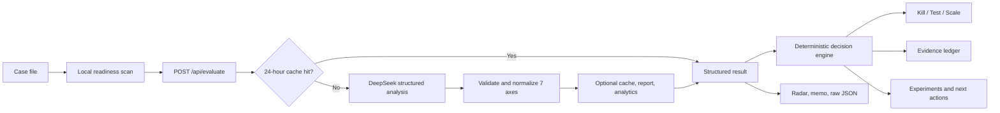

<a id="top"></a>

<div align="center">

# Σ SIGMA

### Venture Validation Workbench

**Evidence first. Hype last.**

Turn a startup pitch into a structured decision: **kill it, test it, or earn the right to scale it.**

[](https://pages.cloudflare.com/)
[](https://www.deepseek.com/)
[](https://developer.mozilla.org/docs/Web/JavaScript)
[](#quick-start)
[](#product-experience)

[Why SIGMA](#why-sigma) · [How it works](#how-it-works) · [Decision engine](#the-decision-engine) · [Quick start](#quick-start) · [API](#api-reference)

</div>

---

## Why SIGMA

AI made creation nearly effortless. It did **not** make direction free.

A team can now produce a landing page, prototype, and thousands of lines of code before answering the expensive question:

> **Does this solve a painful problem for a reachable customer—and is there a credible business behind it?**

SIGMA is a fast, deliberately skeptical workbench for founders, students, product teams, and indie hackers who would rather be corrected early than applauded late. Describe the venture as an operator—not as a pitch deck—and SIGMA converts it into:

- a **0–100 overall score** and concise assessment;
- a **seven-axis validation ledger** with a score and analysis for every axis;
- a **Kill / Test / Scale** recommendation based on visible rules;
- a list of hidden assumptions, contradictions, and “slop,” classified by severity;
- an **evidence ledger** that distinguishes observed, inferred, and guessed claims;
- four inexpensive experiments to run before writing more code;
- a focused action list for the next seven days;
- a radar chart, printable report, founder memo, raw JSON, and local history.

SIGMA is not a substitute for customer interviews, market research, or paid demand. It is the **pre-flight check that tells you what evidence to collect next**.

---

## What SIGMA evaluates

Every venture is examined through seven operating questions:

| Axis | The question SIGMA asks | What a strong case demonstrates |
|---|---|---|
| **1. Problem truth** | Does this problem really exist? | A specific customer experiences recurring, costly, or urgent pain. |
| **2. Solution validity** | Does this solution resolve that pain? | The product mechanism has a credible causal link to the outcome. |
| **3. Revenue potential** | Can this become an economic system? | Pricing, willingness to pay, and unit economics can plausibly work. |
| **4. Market size** | Is the reachable market large enough? | TAM/SAM/SOM are meaningful for the intended venture scale. |
| **5. Differentiation** | Why this instead of an existing alternative? | A real wedge, structural advantage, or defensible constraint exists. |
| **6. Feasibility** | Can the team actually build and operate it? | Technology, resources, regulation, integrations, and complexity are realistic. |
| **7. Scalability** | Can growth become repeatable? | Delivery and distribution can expand without costs growing at the same rate. |

The model returns a score from `0` to `100` and a concrete two-to-four sentence analysis for each axis. It also identifies pitch failure modes such as circular logic, inflated markets, technological overconfidence, absent revenue models, and ignored competition.

### Slop is treated as a first-class output

| Severity | Meaning | Typical response |
|---|---|---|
| `fatal` | The current thesis has a foundational contradiction. | Stop building and rewrite the case. |
| `warn` | A major assumption needs external evidence. | Run a cheap test before increasing scope. |
| `minor` | The case is incomplete but repairable. | Clarify the claim or collect supporting data. |

---

## From pitch to operating decision



### 1. Build a case file

The editor asks for operational facts: customer, painful moment, current workaround, product mechanism, distribution path, price, and constraints. As you type, the browser calculates four lightweight indicators without sending data anywhere:

- character and word count;
- the presence of business signals such as customer, price, revenue, market, cost, and competition;
- risk terms such as regulation, resistance, privacy, dependency, and integration;
- readiness: `draft`, `usable`, or `filed`.

These indicators improve the input; they do **not** influence the server’s score.

### 2. Validate and normalize the request

The Cloudflare Pages Function:

1. applies a best-effort per-IP rate limit;
2. rejects invalid JSON and ideas shorter than 10 characters;
3. caps model input at 3,000 characters;
4. combines the selected locale with `trim().toLowerCase()` input and hashes it with SHA-256;
5. checks the optional 24-hour result cache, isolated by locale.

### 3. Request structured AI analysis

On a cache miss, the API calls `deepseek-chat` with:

- a locale-aware system prompt defining all seven stable axes;
- explicit instructions to treat the submitted idea as untrusted content;
- `temperature: 0.3` for relatively consistent judgments;
- `max_tokens: 2000`;
- JSON response mode;
- a 25-second timeout per attempt;
- exponential backoff with jitter for rate-limit and server failures.

The selected locale controls all human-readable model output. The idea itself may be written in Korean or English. Every normalized axis includes a language-neutral key (`problem`, `solution`, `revenue`, `market`, `differentiation`, `feasibility`, or `scalability`), so translated labels never change decision logic.

The API allows up to three retries after the first attempt. It then parses and normalizes the result into exactly seven keyed axes with canonical localized names and questions.

### 4. Convert analysis into action

The model supplies the analysis. The browser then applies explicit product rules to produce the decision, evidence burden, experiments, and next actions. This keeps SIGMA useful even when an attractive narrative tries to hide a weak operating assumption.

---

## The decision engine

The Kill / Test / Scale recommendation is deterministic and inspectable:

```text
SCALE  if overall score >= 72
       and problem-truth score >= 65
       and the report contains at most 1 slop

KILL   if overall score < 45
       or differentiation score < 40

TEST   otherwise
```

The checks run in that order. A Scale result still recommends obtaining one paid proof before making a larger bet.

### Evidence ledger

SIGMA translates key scores and pitch signals into an evidence status:

| Claim | `observed` | `inferred` | `guessed` |
|---|---:|---:|---:|
| Customer pain | Problem score ≥ 70 | Problem score < 70 | — |
| Willingness to pay | — | Revenue score ≥ 65 | Revenue score < 65 |
| Competitor gap | — | Differentiation score ≥ 65 | Differentiation score < 65 |
| Distribution channel | — | The case names a channel signal | No channel signal is found |
| Build risk | Feasibility score ≥ 70 | Feasibility score < 70 | — |

Each row includes a proof burden—for example, interviewing five users who recently used an ugly workaround or asking for payment before building the complete product.

### Experiments before features

Every result proposes four low-cost validation moves:

1. **Concierge proof** — manually deliver the outcome to three users, informed by the two weakest axes.
2. **Pricing smoke test** — show the exact price to 20 target users and ask for a commitment.
3. **Objection interview** — record why seven users would not adopt the product before defending it.
4. **Channel wedge** — test one narrow audience and measure response without discounts.

The final action strip changes with the verdict: narrow or abandon a weak case, prove the weakest assumption in a test case, or build the smallest repeatable delivery loop in a scale case.

---

## Product experience

SIGMA is built as an operator’s workbench rather than a chat interface.

| Capability | What it does |
|---|---|
| **Korean and English routes** | Opens with a language selector, remembers the browser’s preference, and provides localized workbench shells at `/ko/` and `/en/`. |
| **Sample case files** | Loads realistic school operations, creator tooling, and healthcare queue examples. |
| **Live input signals** | Shows whether the case includes the commercial and operational detail needed for a useful judgment. |
| **Loading skeletons and error states** | Keeps the workflow legible during model latency and turns API failures into actionable messages. |
| **Seven-axis ledger** | Displays every score, question, analysis, and progress rail. |
| **Radar visualization** | Makes the venture’s shape and weakest dimensions visible at a glance. |
| **Local archive** | Stores the eight most recent reports in browser `localStorage`; selecting one restores its idea. |
| **Draft persistence** | Saves and restores the current draft in the same browser. |
| **Founder memo** | Copies a plain-text verdict, rationale, scores, slops, and next steps. |
| **Print and raw JSON** | Supports human review and machine-readable inspection. |
| **Shareable report data** | When report storage is configured, creates an eight-character report ID available for 30 days. |
| **Command menu** | Provides quick access to validate, demo, clear, link, copy, raw, memo, and print actions. |

### Keyboard-first workflow

| Shortcut | Action |
|---|---|
| `/` | Focus the case editor |
| `Cmd/Ctrl + Enter` | Run validation |
| `Cmd/Ctrl + K` | Open the command menu |
| `Esc` | Close the command menu or leave the editor |

The responsive interface supports smaller screens and honors `prefers-reduced-motion`.

---

## Write a case SIGMA can challenge

Vague input produces vague analysis. Include these seven ingredients:

1. **Customer** — one narrow user or buyer, not “everyone.”
2. **Painful moment** — when the problem occurs and what it costs.
3. **Current workaround** — spreadsheets, chat rooms, manual labor, competitors, or doing nothing.
4. **Product mechanism** — exactly how the proposed solution changes the outcome.
5. **Distribution** — how the first 10 and first 100 customers will hear about it.
6. **Economics** — price, buyer, delivery cost, and expected frequency.
7. **Constraints** — regulation, integration, behavior change, technical risk, or incumbent response.

Example:

```text
A queue-transparency service for neighborhood clinics. Patients see an estimated
wait before choosing whether to book or visit, while the clinic updates the flow
from its reception screen. Clinics pay ₩100,000 per month. The largest risks are
integration with existing systems, patient privacy, and resistance from reception staff.
```

That case is more useful than “Uber for clinic waiting” because its assumptions can be disproved.

---

## Technical architecture

SIGMA intentionally keeps the stack small:

- **Frontend:** a framework-free language selector, localized Korean and English workbench shells, shared styling, and locale dictionaries;
- **API:** one Cloudflare Pages Function using Web Platform APIs;
- **Model:** DeepSeek Chat through the OpenAI-compatible chat completions endpoint;
- **Optional persistence:** three Cloudflare KV bindings for cache, reports, and aggregate analytics;
- **Deployment:** Cloudflare Pages, with a GitHub Actions workflow on pushes to `main`.

```text
sigma-validator/
├── public/
│   ├── index.html              # Korean/English language selector
│   ├── en/index.html           # English workbench shell and metadata
│   ├── ko/index.html           # Korean workbench shell and metadata
│   ├── _headers                # Static security and cache headers
│   └── assets/
│       ├── app.js              # Shared workbench behavior
│       ├── locale-selector.js  # Browser-local preference and redirect logic
│       ├── locales/
│       │   ├── en.js           # English client copy and case examples
│       │   └── ko.js           # Korean client copy and case examples
│       └── styles.css          # Shared responsive design system
├── functions/
│   └── api/
│       └── evaluate.js         # POST evaluation, GET reports/analytics, reliability controls
├── .github/workflows/
│   └── deploy.yml              # Cloudflare Pages deployment
├── wrangler.toml               # Pages project configuration
└── README.md
```

There is no frontend framework, package manifest, database migration, or compile step. The product uses localized static shells and one edge function, keeping the architecture directly inspectable.

---

## Quick start

### Prerequisites

- Node.js 18 or later;
- a [DeepSeek API key](https://platform.deepseek.com/);
- a Cloudflare account only if you want to deploy or configure KV.

### Run locally

```bash
git clone https://github.com/ghandhitechnology/sigma-validator.git
cd sigma-validator
```

Create a local secret file named `.dev.vars`:

```dotenv
DEEPSEEK_API_KEY=your_deepseek_api_key
```

Then start the Pages development server:

```bash
npx wrangler pages dev public
```

Open the local URL printed by Wrangler, normally `http://localhost:8788`.

> `.dev.vars` is ignored by Git. Never place the API key in `public/` or client-side JavaScript.

### Optional Cloudflare KV bindings

The core evaluator only requires `DEEPSEEK_API_KEY`. Additional bindings enable the following features:

| Binding | Purpose | Retention |
|---|---|---:|
| `SIGMA_CACHE` | Cache identical normalized evaluations | 24 hours |
| `SIGMA_REPORTS` | Store retrievable report data | 30 days |
| `SIGMA_ANALYTICS` | Track total runs, daily runs, score sum, and errors | No TTL set by the app |

Create KV namespaces and bind them through the Cloudflare dashboard or `wrangler.toml`:

```toml
[[kv_namespaces]]
binding = "SIGMA_CACHE"
id = "<production-namespace-id>"
preview_id = "<preview-namespace-id>"

[[kv_namespaces]]
binding = "SIGMA_REPORTS"
id = "<production-namespace-id>"
preview_id = "<preview-namespace-id>"

[[kv_namespaces]]
binding = "SIGMA_ANALYTICS"
id = "<production-namespace-id>"
preview_id = "<preview-namespace-id>"
```

If a binding is absent or temporarily fails, its feature is skipped without blocking the evaluation.

### Deploy

Authenticate Wrangler, configure the production secret, and deploy:

```bash
npx wrangler login
npx wrangler pages secret put DEEPSEEK_API_KEY
npx wrangler pages deploy public --project-name sigma-validator
```

The included GitHub Actions workflow also deploys pushes to `main` when these repository secrets are configured:

- `CLOUDFLARE_API_TOKEN`
- `GITHUB_TOKEN` (provided automatically by GitHub Actions)

---

## API reference

### `POST /api/evaluate?locale=ko|en`

Evaluates a startup idea. `locale` defaults to `ko` for backward compatibility. Supplying it in both the query and body lets the API localize failures that happen before body parsing; the body value is authoritative after parsing.

**Request**

```json
{
  "idea": "A specific startup case with customer, pain, workaround, product, distribution, price, and constraints.",
  "locale": "en"
}
```

**Successful response**

```json
{
  "overall_score": 63,
  "summary": "The problem is credible, but willingness to pay and differentiation need external proof.",
  "axes": [
    {
      "key": "problem",
      "name": "Problem Authenticity",
      "question": "Does this problem genuinely exist?",
      "score": 74,
      "analysis": "A concrete, evidence-led analysis."
    }
  ],
  "slops": [
    {
      "type": "Ignored competition",
      "severity": "warn",
      "description": "The structural difference from existing alternatives is not adequately explained."
    }
  ],
  "locale": "en",
  "reportId": "a1b2c3d4"
}
```

The real response contains exactly seven axis entries. `reportId` is present only when report storage succeeds.

### `GET /api/evaluate?report=<reportId>`

Returns a stored report when `SIGMA_REPORTS` is configured and the report has not expired.

### `GET /api/evaluate`

Returns API health and version information:

```json
{ "ok": true, "version": "3.0", "locales": ["ko", "en"] }
```

### Error contract

Errors use a stable JSON shape:

```json
{
  "error": true,
  "code": "INPUT_TOO_SHORT",
  "message": "아이디어가 너무 짧습니다. 최소 10자 이상 입력하세요."
}
```

Possible codes include `INVALID_JSON`, `INPUT_TOO_SHORT`, `RATE_LIMITED`, `API_KEY_MISSING`, `UPSTREAM_TIMEOUT`, `UPSTREAM_ERROR`, `EMPTY_RESPONSE`, `PARSE_ERROR`, `INVALID_STRUCTURE`, and `NOT_FOUND`. Retryable upstream errors include `"retryable": true`.

---

## Reliability, security, and privacy

### Reliability controls

- Up to **10 requests per IP per minute** using an in-memory, per-worker limiter.
- Up to **three retries** with exponential backoff for HTTP `429` and `5xx` responses.
- **25-second timeout** for each model request attempt.
- **24-hour content-addressed cache** when `SIGMA_CACHE` is available.
- Analytics, cache writes, and report writes are non-blocking optional operations.
- Client-side loading, timeout, rate-limit, server, and malformed-response states.

The rate limiter is intentionally lightweight: it resets on worker cold starts and is not a globally durable abuse-prevention system.

### Security controls

- The DeepSeek key remains in the server-side Cloudflare environment.
- Model and user content is escaped before dynamic HTML rendering.
- API responses include a restrictive Content Security Policy, `nosniff`, frame denial, strict referrer, and permissions headers.
- Static pages and assets receive a self-only script/style policy plus framing, referrer, permissions, opener, resource, and transport protections from `public/_headers`.
- Inputs are type-checked, length-checked, and capped before model submission.
- Cache keys use SHA-256 rather than storing the idea as a key.

The API currently permits cross-origin requests with `Access-Control-Allow-Origin: *`; tighten this policy if deploying SIGMA for a private organization.

### Data handling

- The language preference, shared draft, and up to eight evaluation history entries per locale—including their idea text—are stored only in the user’s browser.
- Returning root-route visitors are redirected to their stored locale; the language switch preserves the current draft while archives remain separated by locale.
- Each evaluation sends the case text to DeepSeek for analysis.
- If `SIGMA_REPORTS` is enabled, up to the first 500 characters of the idea and its result are stored for 30 days.
- If `SIGMA_ANALYTICS` is enabled, the app records aggregate counters—not the full idea text.

Review DeepSeek and Cloudflare data policies before using sensitive, personal, regulated, or confidential information.

---

## Design principles

1. **Evidence over eloquence** — a better pitch should not rescue a weak mechanism.
2. **Visible rules over mysterious verdicts** — decision thresholds are readable in the client.
3. **Experiments before features** — every report ends with external proof steps.
4. **Graceful degradation** — cache, sharing, and analytics are optional; evaluation remains the core path.
5. **Small, inspectable software** — the entire product is a static workbench and one edge function.

---

<div align="center">

### Creation is cheap. Wrong direction is still expensive.

**Write the case. Find the weak claim. Run the cheapest honest test.**

[Explore the source](https://github.com/ghandhitechnology/sigma-validator) · [Back to top](#top)

</div>
